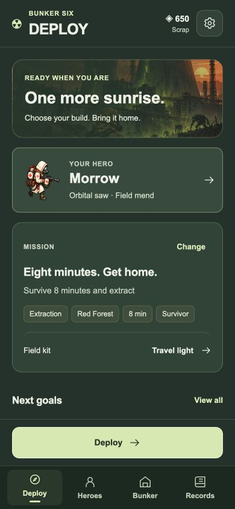
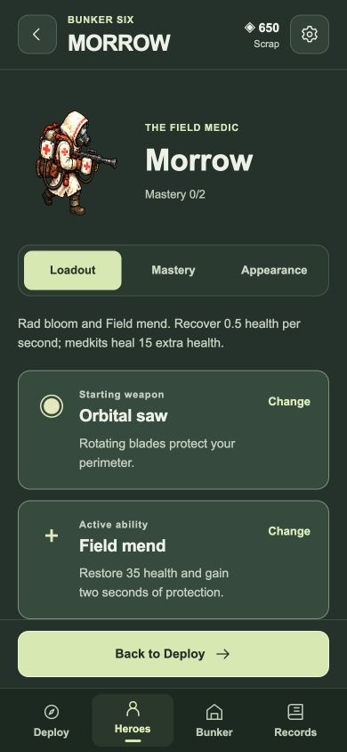
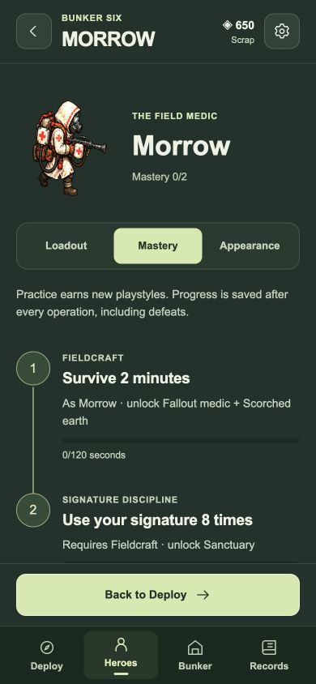
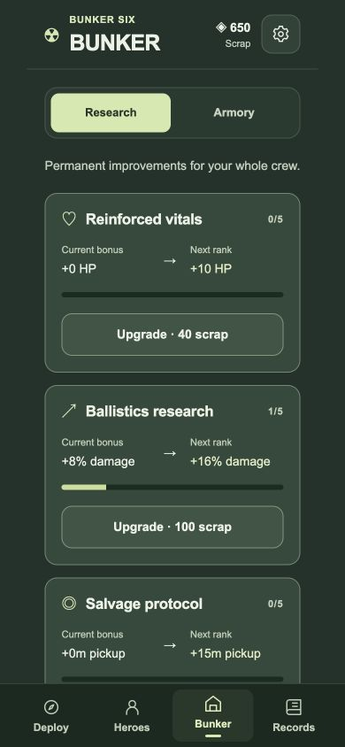

# Mobile presentation review — Field Build 1.5

This revision uses the supplied **Mobile Game UX Handbook v1.2**, particularly its foundations, depth management, action/roguelike, accessibility, feedback, and evaluation chapters. The source handbook remains a user attachment; it is not redistributed in the repository.

## Decisions

| Handbook principle                  | Change in Nuclear Survivors                                                                                                                                                                     |
| ----------------------------------- | ----------------------------------------------------------------------------------------------------------------------------------------------------------------------------------------------- |
| Give each screen one clear purpose  | Four stable destinations: Deploy, Heroes, Bunker, Records. Mission preparation is separate from the shared shop.                                                                                |
| Keep the main action easy to reach  | Deploy/Resume, Use hero, and Retry/Continue remain above the bottom navigation. Short landscape screens use a navigation rail.                                                                  |
| Put complexity where it belongs     | Each hero owns Loadout, Mastery, Appearance. Shared Research and Armory live in Bunker. Codex entries, evolution rules, backups, and debrief details expand on demand.                          |
| Explain progression and value       | Research shows current → next bonus. Mastery shows two connected earned milestones and their rewards. Locked heroes show their free feat and signature gear before a scrap purchase.            |
| Preserve context                    | Lists, categories, expanded details, and same-view focus survive rendering and short navigation round trips. Deployment choices persist after reload.                                           |
| Make actions deliberate and legible | Inspecting a hero/sector does not buy it. Shared unlocks do not silently equip gear. Equipped, owned, available, and locked states have text/symbols. Purchases give a wallet update and toast. |
| Respect the return loop             | Debriefs prioritize outcome, total scrap, new unlocks, and direct retry. No extra reward-claim step. Replacing an unfinished operation requires an explicit choice.                             |
| Support mobile reading and reach    | Opaque lighter surfaces, readable body copy, 44px discrete controls, safe-area padding, sticky section navigation, visible focus, and existing reduced-motion support.                          |

## Screens

Screenshots were captured from a desktop browser using a 390 × 844 CSS-pixel viewport and a disposable local test profile. They are layout evidence, not physical iPhone captures.

| Deploy                               | Hero loadout                 |
| ------------------------------------ | ---------------------------- |
|  |  |

| Hero mastery                    | Shared research                         |
| ------------------------------- | --------------------------------------- |
|  |  |

## Verification

Automated tests cover the menu model, saved selection validation, malformed optional deployment data, legacy profile defaults, daily fixed loadout, branch naming, research values, explicit purchase/equip markup, complete debrief totals, checkpoint replacement, and per-view scroll/disclosure restoration. The full suite also checks game simulation, progression, migrations, checkpoints, and offline worker behavior.

Scripted browser checks exercised recruitment without changing the active hero; per-hero weapon changes; explicit hero selection; reload persistence; research purchases and their next-rank values; shared unlocks without loadout changes; extraction/daily mission preparation; Codex disclosure restoration; starting the configured operation; pause → settings → pause; and run settlement/debrief. A purchase near the bottom of Armory retained a nonzero scroll position (2053px) rather than resetting to the top. No browser warnings or errors were observed during these flows.

Responsive checks at 320 × 568, 390 × 844, 844 × 390, 768 × 1024, and 1280 × 800 found no horizontal overflow. The fixed primary action and stable navigation remained reachable. Landscape was checked with the side rail. Existing `viewport-fit=cover`, safe-area variables, and opaque status-bar treatment remain intact.

Physical iPhone Safari/PWA testing is still needed for notch/home-indicator insets, system text enlargement, VoiceOver, one-thumb reach, multi-touch, and install/update behavior. No human usability study, completion-time measurement, or accessibility certification is claimed by these scripted checks.

## Maintenance

Menu markup is pure in `src/presentation.js`; browser-independent menu data lives in `src/menu-model.js`. Routing and persistence stay in `src/main.js`/`src/profile.js`, and view restoration in `src/menu.js`. Profile version two and checkpoint version one remain supported. No new runtime assets or external dependencies were added.
